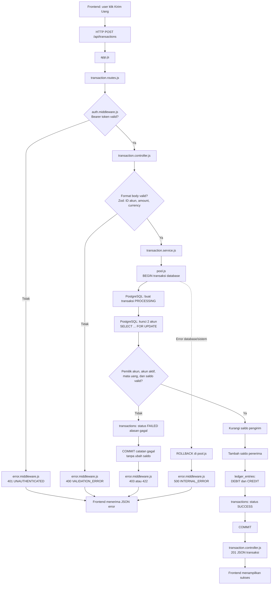
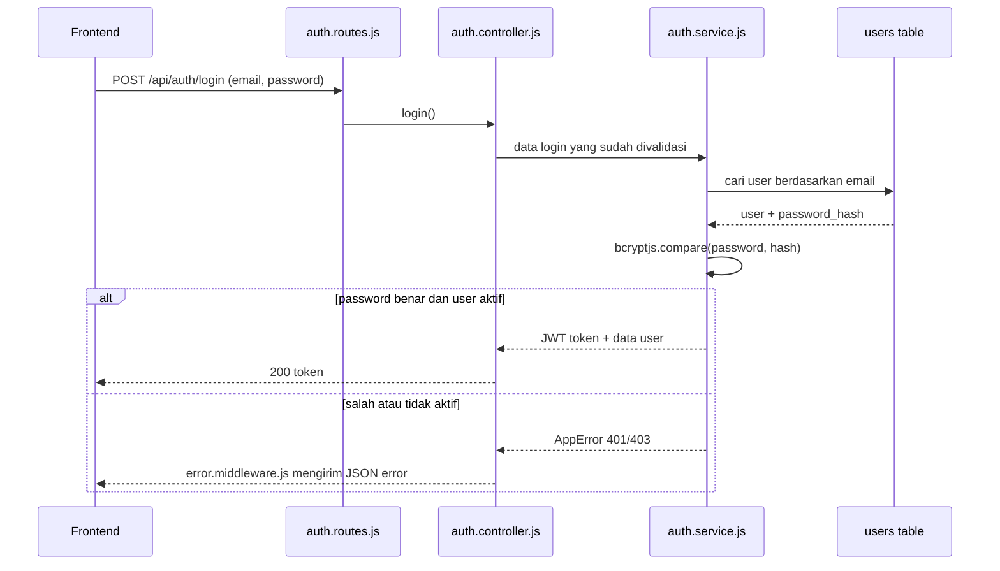
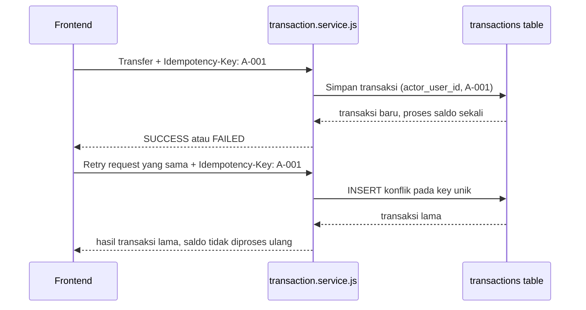
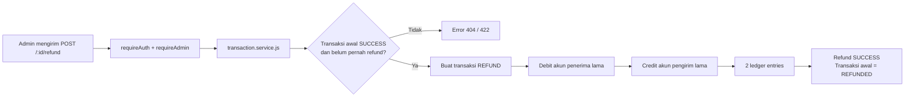

# Alur backend transaksi: dari frontend sampai database

Dokumen ini menjelaskan ke mana data berjalan, apa yang dilakukan setiap file, dan ke mana proses berpindah saat terjadi kesalahan.

## Cara memakai diagram di Notion

Salin isi salah satu blok `mermaid` di bawah ke blok kode di Notion. Bila workspace Notion Anda belum menampilkan diagram Mermaid sebagai visual, simpan blok ini sebagai dokumentasi sumber; Anda dapat merendernya di Mermaid Live Editor lalu memasukkan hasil PNG/SVG ke halaman Notion.

## Diagram utama: transfer dari frontend



## Apa yang frontend kirim

Frontend tidak mengirim saldo baru. Frontend hanya mengirim **perintah transfer** berikut:

```json
{
  "senderAccountId": "aaaaaaaa-aaaa-aaaa-aaaa-aaaaaaaaaaaa",
  "receiverAccountId": "bbbbbbbb-bbbb-bbbb-bbbb-bbbbbbbbbbbb",
  "amount": "25000.00",
  "currency": "IDR",
  "description": "Bayar makan"
}
```

Header wajib:

```http
Authorization: Bearer <token_login>
Idempotency-Key: transfer-andi-ke-budi-001
```

- `Authorization` menjawab: **siapa pengirim yang sedang login?**
- `senderAccountId` menjawab: **akun mana yang akan didebit?**
- `receiverAccountId` menjawab: **akun mana yang akan menerima?**
- `amount` adalah nominal sebagai string agar nilai uang tidak terkena masalah pembulatan JavaScript.
- `Idempotency-Key` menjawab: **apakah ini retry dari perintah yang sama?** Key yang sama tidak boleh membuat potongan saldo kedua kali.

## Diagram login



## Diagram ketika request dikirim dua kali



## Diagram refund



Refund tidak menghapus transaksi awal. Ia membuat transaksi kebalikan agar jejak audit tetap ada.

## Peta file dan tugasnya

| File | Saat dipakai | Apa yang dilakukan | Lanjut ke / hasil |
| --- | --- | --- | --- |
| `src/server.js` | Saat `npm run dev` | Memeriksa koneksi database dan menyalakan server. | Memuat `app.js`. Bila DB tidak bisa dihubungi, server berhenti. |
| `src/app.js` | Setiap HTTP request | Mengaktifkan pembaca JSON, memasang endpoint dan error handler. | Mengarahkan `/api/auth` dan `/api/transactions` ke routes. |
| `src/routes/auth.routes.js` | `POST /api/auth/login` | Memilih controller login dan menangkap error async. | Ke `auth.controller.js`. |
| `src/routes/transaction.routes.js` | Endpoint transaksi | Menentukan URL transaksi dan memasang `requireAuth`; refund juga memakai `requireAdmin`. | Ke middleware, lalu controller. |
| `src/middleware/auth.middleware.js` | Sebelum controller transaksi | Membaca `Authorization: Bearer ...`, memverifikasi JWT, mengisi `req.user`. | Token benar → controller. Salah → `error.middleware.js` dengan 401. |
| `src/middleware/error.middleware.js` | Bila file lain memanggil `next(error)` atau melempar error | Mengubah error menjadi JSON konsisten. | Mengirim 400, 401, 403, 409, 422, atau 500 ke frontend. |
| `src/controllers/auth.controller.js` | Saat login | Memeriksa format email/password dengan Zod. | Ke `auth.service.js`. Format salah → error handler. |
| `src/controllers/transaction.controller.js` | Saat transfer/refund | Memeriksa body transfer dan header `Idempotency-Key`; menentukan status respons HTTP. | Ke `transaction.service.js`. |
| `src/services/auth.service.js` | Setelah controller login | Mencari user, memeriksa password hash, membuat JWT. | Ke tabel `users`; sukses → token, salah → error. |
| `src/services/transaction.service.js` | Setelah controller transfer/refund | Seluruh aturan uang: cek user, kepemilikan akun, saldo, lock akun, ledger, idempotensi, refund. | Ke `pool.js` dan tabel transaksi. |
| `src/db/pool.js` | Saat service perlu database | Membuat koneksi PostgreSQL dan fungsi `BEGIN`/`COMMIT`/`ROLLBACK`. | Sukses → commit; error sistem → rollback. |
| `src/errors/app-error.js` | Saat aturan bisnis gagal | Bentuk error dengan kode HTTP dan kode bisnis. | Ditangkap error middleware. |
| `src/config/env.js` | Saat server mulai | Membaca `.env`, mewajibkan `DATABASE_URL` dan `JWT_SECRET`. | Jika belum ada, server gagal mulai dengan pesan jelas. |
| `db/init/001-schema.sql` | Saat database baru dibuat | Membuat tipe enum, `users`, `accounts`, `transactions`, dan `ledger_entries`. | Menjadi struktur data PostgreSQL. |
| `db/init/002-seed.sql` | Sesudah schema dibuat | Mengisi Andi, Budi, admin, serta saldo awal untuk belajar. | Data siap dipakai login/transfer. |
| `docker-compose.yml` | Saat `docker compose up -d` | Menjalankan PostgreSQL dan otomatis menjalankan dua file SQL awal. | Database `transaksi_db` aktif pada port 5432. |
| `.env.example` | Sebelum menjalankan API | Contoh variabel koneksi database dan rahasia JWT. | Disalin menjadi `.env`. |
| `package.json` | Saat memasang/menjalankan proyek | Daftar library dan perintah `npm run dev`, `npm start`, `npm run check`. | Node.js menjalankan server. |
| `package-lock.json` | Saat `npm install` | Mengunci versi paket yang dipasang. | Jangan diedit manual. |
| `.gitignore` | Saat memakai Git | Mencegah `node_modules` dan `.env` ikut disimpan. | Rahasia tidak ikut terunggah. |
| `README.md` | Saat belajar/menjalankan | Ringkasan setup, contoh request, dan penjelasan desain. | Referensi singkat proyek. |

## Jalur salah: file mana yang menangani?

| Masalah | Berhenti di file | Apa yang terjadi pada saldo | Respons frontend |
| --- | --- | --- | --- |
| Token kosong/salah | `auth.middleware.js` → `error.middleware.js` | Tidak berubah. | `401 UNAUTHENTICATED` |
| Body JSON tidak valid | `app.js` → `error.middleware.js` | Tidak berubah. | `400` |
| ID akun atau amount salah | `transaction.controller.js` → `error.middleware.js` | Tidak berubah. | `400 VALIDATION_ERROR` |
| Akun pengirim bukan milik user login | `transaction.service.js` → `error.middleware.js` | Tidak berubah; transaksi dicatat `FAILED`. | `403 SENDER_NOT_OWNED` |
| Saldo kurang | `transaction.service.js` → `error.middleware.js` | Tidak berubah; transaksi dicatat `FAILED`. | `422 INSUFFICIENT_BALANCE` |
| Database putus/error sistem | `pool.js` melakukan `ROLLBACK` → `error.middleware.js` | Semua perubahan request itu dibatalkan. | `500 INTERNAL_ERROR` |
| Request dikirim ulang | `transaction.service.js` memeriksa key unik di tabel `transactions` | Tidak dipotong kedua kali. | Hasil transaksi sebelumnya |
